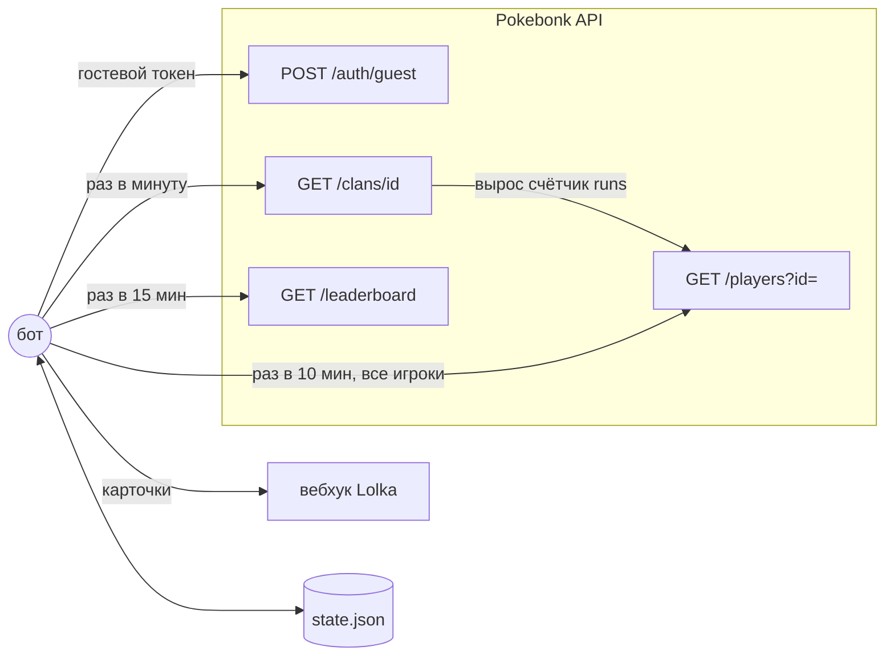
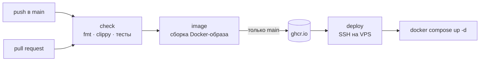

# pokebonk-lolka

Бот, который присылает в канал [Lolka](https://lolka.app) карточки о забегах игроков
браузерной игры [Pokebonk](https://pokebonk.com): кто играл, каким покемоном, во что он
эволюционировал, сколько продержался и что выбил.

```
🏆 3x1ee — победа!
Бульбазавр → Венузавр
Лес · тир 0 · стадия 4
⏱ Время 32:28   💀 Убийства 28 077   🎯 Режим рейтинговый
Достижения: ✨ Шайни: +1
[ANP] · #41 800 из 122 096 · Pokebonk
```

Что ещё сообщает:

- 👋 / 🚪 кто вступил в клан или вышел из него, 🎖 смена ролей, ✏️ смена ника;
- 🥇 первая победа, ✨ шайни, 👑 легендарки, 🏅 медали за время, 📈 личные рекорды;
- для побед и долгих забегов — сборка: приёмы с долей урона, главные предметы, витамины
  и несколько ключевых статов (урон, скорость атаки, крит, снаряды, ОЗ, броня);
- ⏰ напоминание о конце сезона, 🏁 итог клана за сезон, 🌱 начало нового сезона;
- 📣 объявления разработчиков (поле `message` в информации о сезоне).

Бот на Rust: занимает ~5–10 МБ памяти, образ Docker весит ~10 МБ.

## Как это работает



1. **Раз в минуту** бот запрашивает клан. В ответе у каждого участника есть счётчик
   `runs`; если он вырос, бот сразу запрашивает профиль игрока и отправляет новые забеги.
2. **Раз в 10 минут** проверяются профили всех отслеживаемых игроков. Это ловит забеги,
   которые не идут в зачёт клана (нерейтинговые), и игроков из `POKEBONK_PLAYERS`.
3. **Раз в 15 минут** — информация о сезоне.
4. `/clans` и `/leaderboard` требуют сессию. Бот сам создаёт гостевую через
   `POST /auth/guest` и заводит новую, когда сервер отвечает «Tu sesión ha caducado».
5. Всё увиденное хранится в `state.json`. Новый игрок сначала просто запоминается,
   поэтому после запуска бот не заспамит канал старыми забегами. Если Lolka недоступна,
   сообщения ждут в очереди и уходят позже.

## Структура

```
src/
  main.rs        запуск, команды, обработка сигналов
  config.rs      настройки из переменных окружения
  tracker.rs     основной цикл: опрос -> сравнение -> отправка
  events.rs      чистая логика «что изменилось» (основные тесты здесь)
  render.rs      оформление карточек и упаковка в сообщения
  pokebonk.rs    клиент API Pokebonk + гостевая сессия
  lolka.rs       отправка в вебхук, обработка 429 / Retry-After
  model.rs       типы данных
  state.rs       state.json (атомарная запись)
  names.rs       имена покемонов, биомы, роли
deploy/
  docker-compose.yml   запуск на VPS
  remote-deploy.sh     скрипт выкладки (вызывается на VPS)
  bot.env.example      пример настроек
scripts/
  ci-local.ps1   локальный CI на Windows (в Docker, Rust ставить не нужно)
  deploy.ps1     локальный CD с Windows: собрать здесь -> развернуть на VPS
  deploy.sh      то же для Linux / macOS / WSL
.github/workflows/ci-cd.yml   CI/CD в GitHub Actions
```

## Настройки

Задаются переменными окружения; на сервере — в файле `bot.env`
(шаблон: [`deploy/bot.env.example`](deploy/bot.env.example)).

| Переменная | По умолчанию | Что делает |
|---|---|---|
| `LOLKA_WEBHOOK_URL` | — (обязательно) | URL вебхука: настройки канала → Интеграции → Вебхуки |
| `POKEBONK_CLAN_ID` | — | id клана; отслеживаются все участники |
| `POKEBONK_PLAYERS` | — | ники через запятую (нужен клан и/или ники) |
| `WEBHOOK_USERNAME` | имя вебхука | имя автора сообщений |
| `CLAN_POLL_SECS` | 60 | как часто опрашивать клан |
| `PLAYERS_POLL_SECS` | 600 | как часто проверять всех игроков |
| `SEASON_POLL_SECS` | 900 | как часто проверять сезон (0 — выключить) |
| `SEASON_REMIND_HOURS` | 24 | за сколько часов напомнить о конце сезона (0 — не напоминать) |
| `BUILD_DETAILS` | long | сборка в карточке: `off`, `wins` — только победы, `long` — победы и забеги от 5 мин, `all` |
| `SPRITE_URL` | спрайты PokeAPI | картинка покемона, `{id}` — номер; пусто — без картинки |
| `PLAYER_URL` | — | ссылка на профиль в заголовке, `{id}` / `{name}` |
| `DRY_RUN` | 0 | 1 — не отправлять в Lolka, только печатать в лог |
| `LOG_LEVEL` | info | error / warn / info / debug |
| `STATE_PATH` | /data/state.json | где хранить состояние |

Команды: `pokebonk-lolka` — запуск, `pokebonk-lolka test-webhook` — отправить тестовое
сообщение и выйти, `pokebonk-lolka --version`.

## Локальный запуск

С установленным Rust (PowerShell):

```powershell
$env:LOLKA_WEBHOOK_URL = "https://lolka.app/api/webhooks/…"
$env:POKEBONK_CLAN_ID  = "a93a1cc4-c624-462f-addf-3c61d51286c2"
$env:STATE_PATH        = "state.json"
$env:DRY_RUN           = "1"      # сначала посмотреть, что бот отправил бы
cargo run
```

Без Rust, только Docker:

```powershell
docker build -t pokebonk-lolka:dev .
docker run --rm --env-file deploy/bot.env -v pokebonk-state:/data pokebonk-lolka:dev
```

## CI/CD

Есть два пути, оба приводят к одному результату на VPS.

### Путь 1. GitHub Actions (основной)

Файл: [`.github/workflows/ci-cd.yml`](.github/workflows/ci-cd.yml).



- **check** — `cargo fmt --check`, `cargo clippy -D warnings`, `cargo test`.
- **image** — сборка образа; на `main` публикуется в GitHub Container Registry с тегами
  `sha-<коммит>` и `latest`. В pull request образ только собирается, для проверки.
- **deploy** — по SSH копирует `deploy/*` на сервер, временно логинится в ghcr.io
  токеном job'а, скачивает образ `sha-<коммит>` и перезапускает контейнер. Если бот
  не поднялся за 10 секунд, job падает красным.

### Путь 2. Локально со своего ПК

Без GitHub и без реестра: образ собирается на ПК и отправляется на VPS по SSH.

```powershell
.\scripts\ci-local.ps1                      # только проверки (в Docker)
.\scripts\ci-local.ps1 -Image               # проверки + сборка образа
.\scripts\deploy.ps1 -Server deploy@1.2.3.4 # проверки + сборка + выкладка
```

Linux / macOS / WSL: `./scripts/deploy.sh deploy@1.2.3.4`.

Хотите прогнать сам workflow GitHub Actions у себя — есть [act](https://github.com/nektos/act):
`act -j check`.

## Первая настройка

### 1. VPS (Ubuntu / Debian)

Под root:

```bash
curl -fsSL https://get.docker.com | sh          # Docker + compose plugin
adduser --disabled-password --gecos "" deploy   # отдельный пользователь для деплоя
usermod -aG docker deploy
```

Настройки бота (один раз):

```bash
sudo -iu deploy
mkdir -p ~/pokebonk-lolka && cd ~/pokebonk-lolka
nano bot.env          # вставьте содержимое deploy/bot.env.example и заполните
chmod 600 bot.env
```

### 2. SSH-ключ для деплоя

На своём ПК (на вопрос о пароле — просто Enter):

```powershell
ssh-keygen -t ed25519 -f deploy_key -C github-actions
```

Публичную часть — на сервер:

```bash
# на VPS под root
mkdir -p /home/deploy/.ssh
echo "содержимое deploy_key.pub" >> /home/deploy/.ssh/authorized_keys
chown -R deploy:deploy /home/deploy/.ssh
chmod 700 /home/deploy/.ssh && chmod 600 /home/deploy/.ssh/authorized_keys
```

Проверка с ПК: `ssh -i deploy_key deploy@IP_СЕРВЕРА docker ps`.

### 3. GitHub

1. Создайте репозиторий и запушьте код:
   ```powershell
   git init -b main
   git add .
   git commit -m "pokebonk-lolka"
   git remote add origin https://github.com/<вы>/pokebonk-lolka.git
   git push -u origin main
   ```
2. **Settings → Environments → New environment** → `production` и в нём секреты:

   | Секрет | Значение |
   |---|---|
   | `VPS_HOST` | IP или домен сервера |
   | `VPS_USER` | `deploy` |
   | `VPS_PORT` | порт SSH, если не 22 (необязательно) |
   | `VPS_SSH_KEY` | всё содержимое файла `deploy_key` (приватного) |
   | `VPS_KNOWN_HOSTS` | вывод `ssh-keyscan IP_СЕРВЕРА` |

   Совет: в том же окружении включите **Required reviewers** — тогда каждый деплой
   будет ждать вашего нажатия «Approve». Хорошо для тренировки.
3. Сделайте любой push в `main` и смотрите вкладку **Actions**.

После этого `deploy_key` на ПК можно удалить: он нужен только GitHub.

## На сервере

```bash
cd ~/pokebonk-lolka
docker compose logs -f                      # логи
docker compose restart                      # перезапуск (например, после правки bot.env)
docker compose run --rm bot test-webhook    # тестовое сообщение в канал
docker stats pokebonk-lolka                 # сколько ест памяти
```

**Откат на прошлую версию:** во вкладке Actions откройте запуск нужного коммита и нажмите
*Re-run jobs* → deploy. Или вручную на сервере (если пакет в ghcr.io публичный или вы
залогинены): `IMAGE=ghcr.io/<вы>/pokebonk-lolka:sha-<коммит> sh remote-deploy.sh`.

## Заметки

- **Cargo.lock.** После первой сборки (`cargo build` локально или в `ci-local.ps1`)
  закоммитьте `Cargo.lock` — тогда версии зависимостей везде будут одинаковыми.
- **ARM-сервер** (Oracle Ampere, Raspberry Pi): в workflow и скриптах замените
  `linux/amd64` на `linux/arm64`.
- **Секреты.** URL вебхука — это пароль от канала: только в `bot.env` и секретах GitHub,
  никогда в коде. Утёк — перевыпустите токен в настройках вебхука.
- **Вежливость к API.** Бот делает 1–2 запроса в минуту, а нового гостя заводит только
  когда старая сессия истекла (и не чаще раза в 10 минут).
  Не ставьте интервалы меньше минимальных — у игры нет официального API, и злоупотреблять
  им не стоит.
